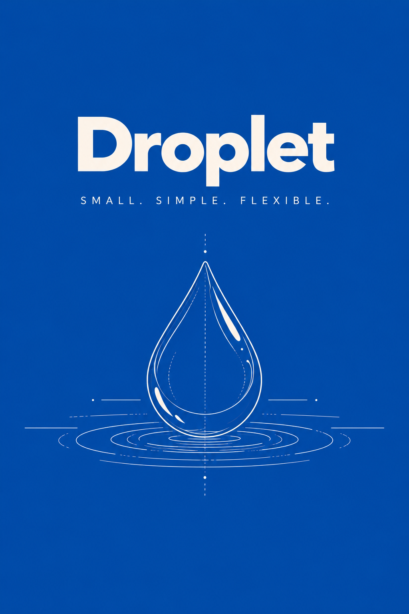

<p align="center">
  
</p>
# Droplet

**Small. Simple. Flexible.**

Droplet is a lightweight, embedded key-value database for Python that supports both in-memory and persistent storage.

Designed to keep data storage simple, Droplet provides a straightforward API for storing, retrieving, and managing Python values without requiring SQL, a database server, or complicated configuration.

By default, Droplet operates entirely in memory. When persistence is needed, switch to persistent mode to store data locally in a single binary file.

## Features

- 🧠 **In-memory storage by default**: Store and retrieve values without disk I/O.
- 💾 **Optional persistence**: Keep data between sessions using a single binary database file.
- ⚡ **Simple API**: Straightforward methods for reading, writing, updating, and deleting values.
- 🐍 **Python type support**: Store strings, integers, floats, booleans, bytes, UUIDs, dictionaries, lists, and tuples.
- 🗂️ **Namespaces**: Organize related keys into logical groups.
- 📦 **Batch operations**: Read, write, and delete multiple values efficiently.
- ⏱️ **Time-to-live (TTL)**: Automatically invalidate values after a specified duration.
- 🏗️ **Dataclass support**: Store dataclass instances and reconstruct them when retrieving.
- 🧹 **Database compaction**: Reclaim disk space in persistent databases.
- 🔄 **JSON import / export**: Export stored data to JSON or import JSON into a database.

## Installation

Droplet is available on [PyPI](https://pypi.org/project/droplet-db/).

```bash
pip install droplet-db
```

Requires Python 3.10 or newer.

## Quick Start

Droplet uses in-memory storage by default.

```python
from droplet import Droplet

db = Droplet()

db.set("name", "Stormy")
db.set("age", 25)

print(db.get("name"))  # Stormy
print(db.get("age"))   # 25

```

No files are created in memory mode.

### Persistent storage

To retain your data between sessions, enable persistent mode.

```python
from droplet import Droplet

db = Droplet(mode="persistent")
db.open()

db.set("name", "Stormy")
db.set("age", 25)

db.close()
```

The database is stored in `database.droplet` in the current working directory.

When you reopen it, the data is restored:

```python
db = Droplet(mode="persistent")
db.open()

print(db.get("name"))  # Stormy

db.close()
```

## Storage Modes

Droplet supports two storage modes, both using the same API.

| Feature | Memory | Persistent |
|---|---|---|
| Default mode | Yes | No |
| Disk storage | No | Yes |
| Survives reopening | No | Yes |
| Key-value operations | Yes | Yes |
| Namespaces | Yes | Yes |
| TTL | Yes | Yes |
| Batch operations | Yes | Yes |
| Dataclass support | Yes | Yes |
| Compaction | Not needed | Supported |

### Memory mode

Memory mode is ideal for temporary application data, caching, and other use cases where persistence isn't required.

```python
db = Droplet(mode="memory")

db.set("cache:user:1", {"name": "Stormy"})
db.set("session", "abc123", ttl=300)

```

### Persistent mode

Persistent mode uses a binary file to preserve data between application sessions.

```python
# Default persistent file location
db = Droplet(mode="persistent")

# Store the database in a custom directory
db = Droplet("./storage", mode="persistent")

# Use a custom database filename
db = Droplet("./storage/application.droplet", mode="persistent")
```

Persistent storage uses an append-only binary record format. Database compaction can reclaim space occupied by obsolete records.

## Usage

### Storing and retrieving values

```python
db.set("username", "Stormy")
db.set("preferences", {
    "theme": "dark",
    "notifications": True
})

print(db.get("username"))  # Stormy
print(db.get("preferences")["theme"])  # dark
```

### Namespaces

```python
db.set("1", "Stormy", namespace="users")
db.set("1", "Laptop", namespace="products")

print(db.get("1", namespace="users"))     # Stormy
print(db.get("1", namespace="products"))  # Laptop
```

### Batch operations

```python
db.set_batch({
    "name": "Stormy",
    "age": 25,
    "active": True
})

values = db.get_batch(["name", "age"])
print(values)

db.delete_batch(["name", "age"])
```

### Expiring values

```python
db.set("session", "abc123", ttl=60)
```

The value expires after 60 seconds. Retrieving an expired value raises `KeyError`.

### Dataclass support

```python
from dataclasses import dataclass

@dataclass
class User:
    name: str
    age: int

db.set_as("user", User("Stormy", 25))

user = db.get_as("user", User)
print(user)  # User(name='Stormy', age=25)
```

### Counters

```python
db.set("visits", 0)

db.increment("visits", 5)
db.decrement("visits", 2)

print(db.get("visits"))  # 3
```

### Context managers
```python
from droplet import Droplet

with Droplet(path='app.droplet', mode='persistent') as db:
    db.set('name', 'Stormy')
    print(db.get('name')) # Stormy
    print(db.is_open) # True

print(db.is_open) # False
```

### Inspecting data

```python
print(db.keys())
print(db.values())
print(dict(db.view()))
print(db.count())
```

## How Droplet Works

Droplet maintains a Python dictionary for fast key-value access.

In **memory mode**, values are stored entirely in memory without creating database files.

In **persistent mode**, Droplet additionally writes binary records to disk. When the database is reopened, these records are used to reconstruct its state.

Both modes share the same public API, allowing developers to choose the storage behavior that best suits their application.

Droplet is designed for lightweight, single-threaded use.

## Roadmap

Planned improvements include:

- Transaction support.
- Additional developer utilities.
- Reliability and performance improvements.

## Project Status

Droplet is an **early-stage open-source project under active development**.

The API and binary file format may change before version 1.0.

## Contributing

Bug reports, feature suggestions, and contributions are welcome.

Visit the [GitHub repository](https://github.com/VeronGoggans/Droplet) to open an issue or contribute.

## License

Droplet is released under the MIT License.

See [LICENSE](LICENSE) for details.

---

**Small. Simple. Flexible.**

[GitHub](https://github.com/VeronGoggans/Droplet) · [PyPI](https://pypi.org/project/droplet-db/)
